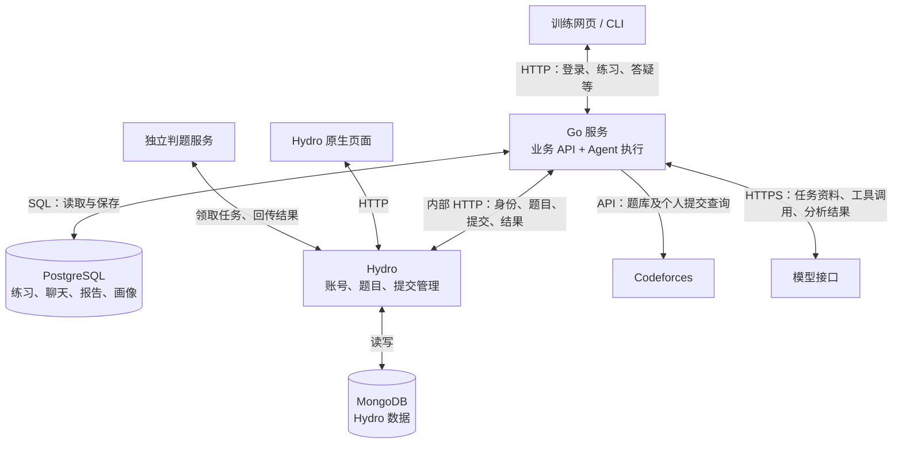
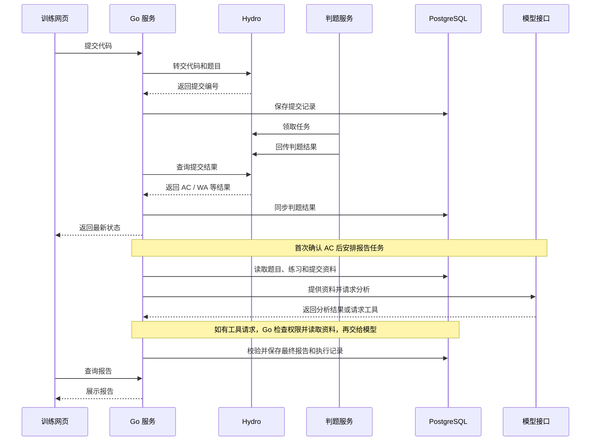
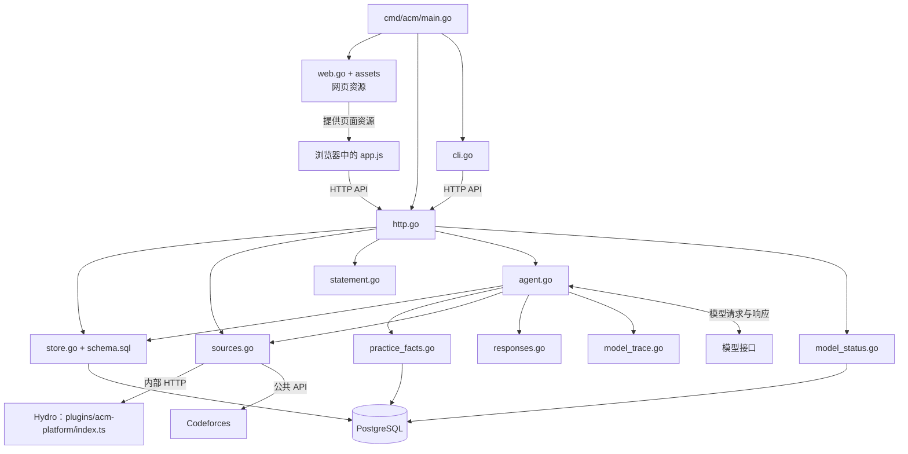

# ACM-OJ 架构说明

本文说明当前项目的服务通信、做题流程和文件结构。图中展示的是主要关系，不包含全部接口和分支。

项目采用“Go 训练平台 + Hydro 判题平台”的结构，没有把 Hydro 重写成 Go。
Go 负责训练记录和 Agent 分析；Hydro 负责账号、题目和判题。

## 1. 总体通信



- 训练网页与 CLI 调用同一套 Go API。
- Go 与 Hydro 通过 `/platform/bridge` 通信。接口检查共享密钥、用户权限和记录归属。
- 两个服务各自管理数据库，不跨库直接修改数据。
- 模型不能直接访问数据库。它请求的工具由 Go 执行，并由 Go 检查权限。
- CF 当前提供题目信息和个人提交同步。用户仍在 CF 提交，本站不对 CF 题目本地判题。

## 2. 从提交到报告

以下是 Hydro 本地题目的主要流程。CF 提交不经过本站判题服务。



答疑、画像更新和推荐也遵循“读取资料、模型分析、校验保存、页面展示”的流程。
当前按任务读取有权限的资料，不另建向量数据库，也不使用通用多 Agent 框架。

只有真实判题结果能够证明 AC。模型给出的评价不能代替判题。
后续新增提交继续同步，不会因为练习已经 AC 就停止更新。

## 3. 文件结构与调用关系

### 主要目录

```text
acm-oj-new/
├── acm-platform/                  # Go 训练平台
│   ├── cmd/acm/main.go            # 程序入口，组装服务和 CLI
│   ├── internal/
│   │   ├── platform/
│   │   │   ├── http.go           # API 路由、认证和业务入口
│   │   │   ├── store.go          # PostgreSQL 数据读写
│   │   │   ├── schema.sql        # 数据表定义
│   │   │   ├── sources.go        # Hydro、CF 接口适配
│   │   │   ├── agent.go          # Agent 任务、工具和证据校验
│   │   │   ├── practice_facts.go # 整理提交结果和代码资料
│   │   │   ├── responses.go      # 模型 JSON / SSE 响应解析
│   │   │   ├── model_status.go   # 模型调用状态
│   │   │   ├── model_trace.go    # 调用阶段和耗时日志
│   │   │   └── statement.go      # 多语言题面整理与渲染
│   │   ├── cli/cli.go            # 命令行客户端
│   │   └── web/
│   │       ├── web.go            # 将网页资源打包进 Go 程序
│   │       └── assets/
│   │           ├── index.html    # 页面入口
│   │           ├── app.js        # 页面交互与 API 调用
│   │           └── style.css     # 页面样式
│   ├── scripts/                  # 同步、部署和验收脚本
│   ├── docs/                     # 使用、进度和发布记录
│   ├── Dockerfile                # Go 应用构建
│   └── compose.yaml              # 各项服务的运行配置
├── Hydro/
│   ├── plugins/acm-platform/
│   │   └── index.ts              # 平台桥接：身份、题目、提交等
│   └── install/platform/         # 本项目的构建与启动配置
└── project-docs/                  # 项目说明文档
```

上表省略了 Hydro 原有源码和测试文件。Go 的 `*_test.go` 与对应业务文件放在同一目录。

### 主要调用关系

箭头表示主要调用或数据流，不是完整的 Go 包导入图。
网页资源由 Go 提供，但页面中的 API 请求实际由浏览器发起。



训练平台仍是一个 Go 单体应用，按文件划分职责，没有拆成多个业务微服务。
前端主要使用 HTML、JavaScript 和 CSS，不是独立的 React 或 Vue 项目。

## 4. 开发与部署

- `acm-platform`、`Hydro` 和 `project-docs` 是独立仓库。
- 本地 Mac 用于编辑文件和 Git 操作；构建、格式检查、测试与浏览器验收在服务器 Docker 中执行。
- Docker Compose 组织 Go、PostgreSQL、Hydro、MongoDB 和判题服务。
- 当前面向内部试用。模型调用的间歇性 429 和超时仍由平台 Issue #10 跟踪，尚不能视为公网生产就绪。
